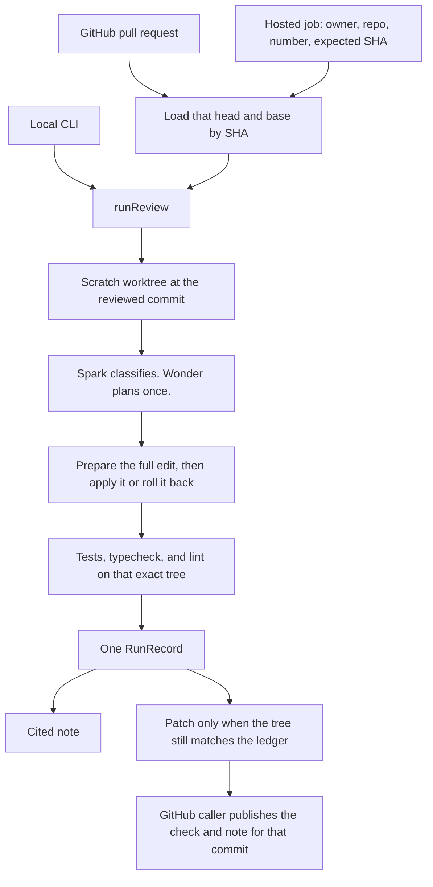

# Architecture

`runReview` owns one review. It resolves the commit, prepares the edit, checks the result, and returns one `RunRecord`. Local commands, a fetched pull request, and the hosted service all call it. GitHub publication sits outside the engine and is pinned to the commit that was reviewed.

## Callers

| Caller | Entry | What it executes |
|---|---|---|
| Local review | `npm run review` | Commands on the machine for a checkout you trust, or in Docker when `--execution docker` is set. |
| Patch-only view | `npm run simplify`, `npm run plan` | The same run. `simplify` reports `accepted` or `refused`. The plan command still requires `--gate-base` and reviews against `--base`. |
| Agent tool | `simplify` and `review_change` | `simplify` returns the patch-only view. `review_change` returns the `RunRecord`. The host chooses the executor. The model does not. |
| GitHub command | `npm run github-pr-review` | Fetches the pull request, then runs in the runner image. Posts the check and the note for that commit. |
| Hosted service | `npm run service` | Queues the same GitHub load. Publication stays off unless the operator turns it on. |

A fetched pull request has no local-process fallback. The runner image is built from `docker/runner.Dockerfile` and is never pulled during a run. The engine records the image id it inspected.

## The run

1. **Resolve.** The checkout is cloned into a scratch worktree and detached at the expected commit. `fixtures/*/sealed/` is left out of the sparse checkout. The caller's checkout is not the worktree.
2. **Prepare.** The executor installs dependencies. For a local run they are copied from the checkout. For Docker, npm installs into a volume (`npm ci` when a lockfile exists, with scripts ignored). Another package manager is refused. If preparation changes the source snapshot, the run fails.
3. **Classify.** Spark (`muse-spark-1.3`) reports findings through one tool call. Citations have to name lines that exist. A finding that cites a sealed path is dropped. Scope creep is computed from the diff, not from the model.
4. **Plan.** Wonder (`muse-wonder-1.0`) is called once. The plan may choose `inline`, `retarget`, `restore-from-base`, `convention-fix`, or `skip`. An invalid plan produces no edits. The model does not supply the bytes that get written.
5. **Prepare each edit.** Code computes the complete write set: generated source for an inline or retarget, the base text for a restore, or the mechanical convention fix. A convention fix runs only when `lesscode-conventions.json` lists that name. An edit that cannot be expressed this way is skipped.
6. **Transaction.** The write set is applied, a structural check runs, and the files roll back — including their previous permissions — when the check rejects the edit. A restore may be kept when the only failing structural check is the size drop. Each finding ends as kept, skipped, rejected, or withdrawn, with the stage that decided it.
7. **Verify.** When at least one edit was kept, tests, typecheck, and lint run once on that tree. The test command is the repository's own `npm test`, followed by the related-test paths. If those commands change the source, every kept edit is withdrawn and no patch is returned. The same happens when a check fails, including a test suite that was already failing on the untouched commit.
8. **Record.** A patch is stored only when the files on disk match the ledger of kept edits and the diff is non-empty. The record holds the diff, its sha256, the Git tree hash, and the paths. The scratch worktree is then deleted.

The note is built from the plan after the edits are decided. An item whose citation does not exist is dropped. An item that asked for an edit which was not kept stays in the note as “Not applied,” with the reason, and no longer orders that edit.

## The gate

A patch is accepted when all of these hold:

- related tests, typecheck, and ESLint on the touched files exit 0
- exports outside the edit set are unchanged
- the code-line size drops, ignoring comment-only hunks
- no surviving function's cyclomatic complexity rises by more than 10%
- the patch removes or skips no test
- the verification commands leave the prepared tree unchanged

The structural checks run inside each edit's transaction. The repository commands run once, after the kept edits are assembled.

## The record

`RunRecord` is the contract shared by the local CLI and the hosted worker. The fields a caller acts on:

- `verdict` — `accepted`, `reviewed`, or `failed`
- `outcome` — `patch-ready`, `review-only`, `no-change`, `unverified`, or `null` when the run failed
- `revision` — the head commit, the comparison base, and whether the scope was declared or inferred
- `edits` — one outcome per finding, with its status and reason
- `review` — the note items and their markdown
- `artifact` — the verified patch, present only for an accepted run
- `gate` — the checks and metrics from the last decision
- `failure` — the stage and message when the run did not finish

`review()` in `src/review/review.ts` returns that record plus the earlier fields (`applied`, `findings`, `summary`). The review command prints the record itself.

## Publication

`runGithubPrReview` loads one immutable head and base, calls the engine once, and refuses to publish a patch whose verification evidence does not match the record. The Check Run conclusion comes from the gate. The comment is the note. If the pull request head moves before publication, the result is not posted to the new commit.

The hosted service stores the job and the artifact. Its request body cannot name a local path, an image, or a publish flag. Publishing remains an operator setting on the runner, and the default is off.
