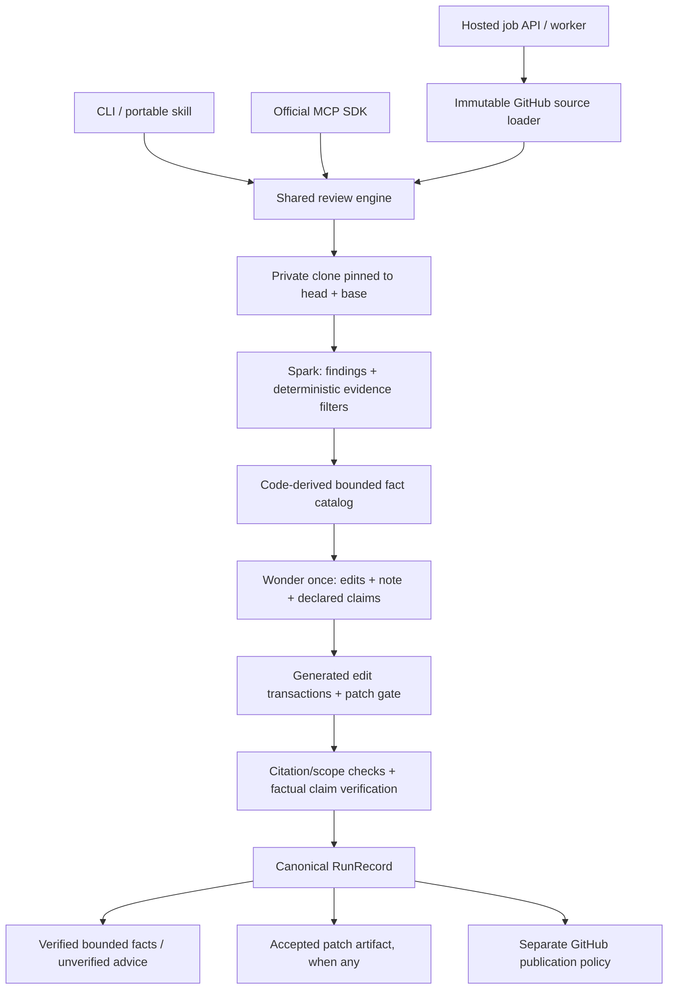

# Architecture

LessCode has one review engine, `runReview`, and one canonical `RunRecord`. Local commands, official MCP transport, the portable skill's CLI command, GitHub review and hosted workers all consume that engine. Publication and deployment policy stay outside it.

The compatibility function `review(checkout, base, intent)` projects the record into `applied`, `review`, `verdict`, `findings` and `gate`, with the full record at `run`. A note-only run succeeds. `simplify` is a legacy patch-only projection, not a second decision engine.

## Responsibilities

| Module | Responsibility |
| --- | --- |
| `src/engine/` | Snapshot identity, transactions, final verification, review assembly and result ownership. |
| `src/source/`, `src/pr/` | Immutable PR head/base loading, declaration/inferred scope, revision-bound GitHub publication. |
| `src/provider/` | Operator credential/endpoint authority, model roles, protocol, timeout/retry and response normalization. |
| `src/execution/` | Trusted local or Docker repository execution; dependency preparation, restricted environment and disposal. |
| `src/classify/`, `src/plan/`, `src/gate/` | Closed findings, supported generated transforms and patch checks. |
| `src/review/claims.ts`, `factCatalog.ts`, `primitiveTrace.ts`, `verifyClaims.ts` | Bounded facts, structured claim checks and code-rendered verified statements. |
| `src/contracts/`, `src/cli/`, `src/mcp/`, `src/tool/` | Canonical input/output schemas and adapters. |
| `src/service/` | Authenticated bounded durable jobs and optional remote-worker delegation. |

## One run

1. Resolve requested base and committed head. Clone privately, detach at the reviewed head and exclude sealed/node_modules paths from source checkout. Copy operator-supplied dependencies only for trusted local use; the caller checkout stays unchanged.
2. Prepare dependencies through the selected executor. Docker uses npm, ignores install scripts, pins an approved preinstalled image and verifies without network access. Source mutation during preparation fails the run.
3. Resolve both model roles before Spark, using one operator environment snapshot and root-bounded configuration. Fetched config has no endpoint/credential authority.
4. Scope context to intent, changed files, related tests and one-hop neighbors. Explicitly requested JavaScript tests are included independently of compiler JS settings. Sealed paths remain excluded; `checkJs` stays as the repository configured it. Context overflow fails before a request.
5. Spark reports findings with `tool_choice: auto`; code checks evidence and structural eligibility. Scope creep is computed from the diff. A schema-validation failure allows one classifier validation retry; HTTP transport retry is separate and only 429/5xx is retried.
6. Construct code-derived facts from the pinned head context. Wonder is called once and returns edit decisions plus review items and any structured factual claims. Invalid output has no model-written patch fallback. The planner counts its complete serialized request before calling a model.
7. Generate and transact supported edits. Inline/retarget use AST codemods, restore uses base text, and convention fixes require registration and an enabled mechanical fix. Protected tests/sealed paths are never edit targets. Structural rejection restores files and permissions.
8. If edits survive, run repository tests, typecheck and lint on that exact cumulative tree, with the existing baseline/structural checks. Command failures, pre-existing test failures and unexpected source mutations cannot produce an accepted patch. The gate establishes bounded properties, not equivalence for untested behavior.
9. Finalize the note: check citations/scope, preserve gate-driven “Not applied” explanations, check declared facts against the head catalog, withhold unsupported/contradicted factual items, render verified factual text from code, and label other advice unverified. No extra Wonder call or repository execution is added for this verification.
10. Return patch only when it is nonempty, accepted and matches the verified ledger/tree. Record the artifact hash, tree identity and paths, then dispose the workspace. A successful run without a patch returns `reviewed`.

## Independent result meanings

- `verdict`, `artifact`, `gate` and top-level `verification` describe patch/execution outcomes.
- `review.items[].verification`, `review.facts` and `review.verification` describe bounded factual checks and unverified advice.
- `audit.reviewVerification` explains withheld declared claims. Raw planner text is diagnostic data, not published verified prose.
- `manifest` records requested/served models, calls, usage/cost completeness, phase times and prompt SHA-256s. It does not contain model keys or request bodies.

See [usage](run.md#interpret-the-record) for consumer behavior and [factual verification](factual-review-verification.md) for supported predicates and assumptions. A source-presence fact does not establish semantic coverage; a conditional primitive trace does not prove whole-program execution. Older records without factual fields have unknown verification.

## Trust and adapters

The installed CLI writes a result file; the development review command prints JSON. MCP uses the official SDK with approved filesystem roots and host-selected execution. The portable skill calls the installed CLI and does not invent a verdict. HTTP MCP is authenticated and isolated; trusted stdio/local execution is an explicit operator choice. See [Consumers](consumers.md).

The built-in provider protocol is OpenAI Chat Completions. Operator-injected `ModelProtocol` implementations can normalize native APIs, but native vendor compatibility is not implied by changing a URL. Policy-selected endpoints and credential bindings are authoritative; see [Providers](providers.md) for actual per-mode precedence.

## Publication and hosting

GitHub publication checks that the PR still has the reviewed head and that an offered artifact matches its evidence. The check conclusion comes from the gate, not a prose note. The command can post checks/comments without offering a patch and never merges or changes the PR branch.

The hosted API queues a GitHub identity and defaults to no publication. Its stored artifact is an outcome envelope containing the canonical `run`. An API host can delegate over private authenticated HTTPS without GitHub/model credentials or Docker authority. Each durable file store has one process owner; API timeout does not establish remote cancellation. See [Hosted deployment](hosted-deployment.md).

The [hardening roadmap](architecture-hardening-plan.md) distinguishes shipped work from transactional scheduling, tenant storage/authorization, remote cancellation and hostile-code isolation still required before a public multi-tenant offering.
